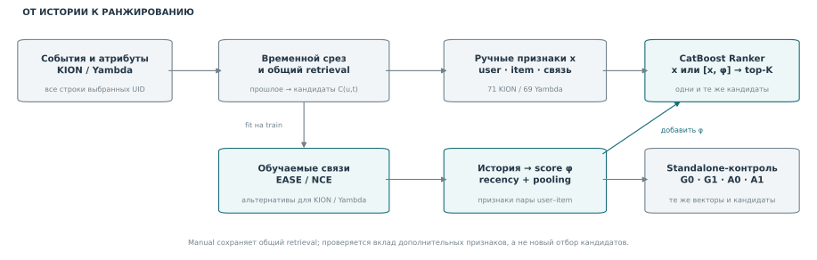
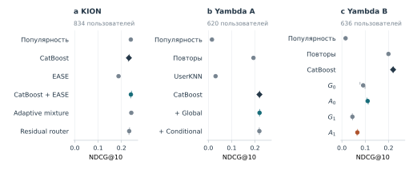

# Обучаемые признаки для рекомендательного ранжирования

Как извлекать признаки из истории взаимодействий и проверять их пользу сверх
сильного CatBoost. В работе сравниваются ручные агрегаты, EASE и контрастивные
представления; отдельно исследуется способ объединения истории пользователя.

**[Отчёт PDF](article.pdf)** · [Архитектура](#архитектура-решения) ·
[Результаты](#результаты) · [Воспроизведение](code/REPRODUCE.md) ·
[CI](https://github.com/YaroslavPelekhov/recsys-feature-learning/actions/workflows/checks.yml)

## Задача

По наблюдавшимся действиям пользователя ранжируем кандидатов. Проверяются
два режима: добавить обученные связи к ручным признакам или использовать
обученный score как самостоятельную модель.

| Данные | Цель | Доступная история |
| --- | --- | --- |
| KION | Новые для пользователя объекты следующей недели | Только доступные до cutoff записи пар; `total_dur` и `watched_pct` исключены |
| Yambda | Треки следующих суток с completion ≥50%, включая повторы | События раньше cutoff минус 30 минут |

Это разные задачи: абсолютные NDCG между KION и Yambda не сравниваются.

## Архитектура решения



### 1. Временной срез и общий retrieval

Выбираются пользователи с сохранением всех исходных строк. Для каждого
момента прогноза восстанавливается история и один общий список `C(u,t)`:
до 240 кандидатов в KION, до 300 в Yambda. Будущие targets в него не
добавляются; пропущенные и cold targets остаются в знаменателях метрик.

Retrieval может включать номинации обученных моделей. Manual сохраняет
тот же pool и retrieval scores/ranks. Поэтому сравнение гибрида измеряет
вклад **добавочных признаков**, а не удаляет из baseline всю обученную информацию.

### 2. Ручная ветвь: история → агрегаты → CatBoost

Для пары user–item считаются характеристики пользователя и объекта, прямые
связи и связи с категорией/исполнителем: частоты, положительные события,
давность и статистики временных окон. Основной набор: 71 признак в KION,
69 в Yambda. CatBoostRanker обучается с YetiRank/NDCG@10.

В KION также проверен ограниченный автоматический поиск окон и half-lives.
Он выбирает масштаб существующих агрегатов. Полный журнал включает
варианты без устойчивого прироста.

### 3. Обучаемая ветвь: история → item–item связи → score пары

EASE и NCE — **альтернативы для разных данных**, не последовательные слои.

| Модель | Устройство | Выход для ранжировщика |
| --- | --- | --- |
| **EASE, KION** | `P=(XᵀX+λI)⁻¹`, `Bᵢⱼ=−Pᵢⱼ/Pⱼⱼ`, `diag(B)=0` на user–item матрице | Два score истории через матрицу `B`, с разным временным взвешиванием |
| **NCE, Yambda** | Две таблицы embeddings по 64 координаты: source и target; dot-product/`√64` | Scores кандидата по взвешенной истории пользователя |

Положительные NCE-пары — соседние положительные прослушивания с лагом до
30 минут за последние 30 дней. Сеть различает их и переставленные продолжения.
Проверяются глобальная перестановка и перестановка внутри **user–day**.
Вторая сохраняет состав музыки пользователя за день и ищет связи сверх него.

### 4. Гибрид и отдельная проверка объединения истории

**Гибрид:** `CatBoost([ручные признаки x, обученные scores φ])`.
Представление и бустинг обучаются отдельными этапами по прошлым данным.

**Самостоятельный score:** на другой когорте фиксируются embeddings, история
и кандидаты; меняются только восстановление фона и объединение экспертов:

| Объединение истории | Без `log q(item)` | С `log q(item)` |
| --- | --- | --- |
| Геометрическое: среднее log-вероятностей | `G0` | `G1` |
| Арифметическое: log смеси вероятностей | `A0` | `A1` |

Основное заранее заданное сравнение — `A1 − G0`. Остальные контрасты
объясняют его, но не заменяют основную гипотезу.

## Результаты

Основная метрика — user-macro NDCG@10. CI — парные 95% интервалы с
пересэмплированием пользователей; они не учитывают вариативность новых обучений.

| Проверка | Измеренный эффект | Вывод |
| --- | --- | --- |
| KION: CatBoost + EASE против manual | 0,23173 → 0,24033; Δ +0,00860, CI [+0,00584; +0,01188] | Прирост к manual; преимущество над popularity не установлено |
| Yambda A: conditional против global | Δ −0,00075, CI [−0,00197; +0,00037] | Преимущество условного фона не подтверждено |
| Yambda B: основное `A1 − G0` | Δ −0,02471, CI [−0,03280; −0,01652] | Реконструкция ухудшила качество |
| Yambda B: вторичное `A0 − G0` | 0,09111 → 0,11043 | Выше своего baseline, ниже manual 0,21944 |

Низкий contrastive loss не гарантирует полезного ranking score. Обученные
представления в этом протоколе не заменили сильные ручные агрегаты.
[Полные отчёты](code/reports/README.md) сохраняют все этапы и неудачные варианты.



Ромб — ручной CatBoost; малые отметки — отдельные pipeline seeds.
Доверительные интервалы эффектов приведены в статье.

## Где это реализовано

| Компонент | Код |
| --- | --- |
| KION: данные, признаки и кандидаты | [data.py](code/src/rec/data.py), [features.py](code/src/rec/features.py), [retrieval.py](code/src/rec/retrieval.py) |
| Yambda snapshots и ручные признаки | [music.py](code/src/rec/music.py) |
| EASE и временные профили | [linear.py](code/src/rec/linear.py) |
| Переходы, перестановки, NCE | [transition.py](code/src/rec/transition.py) |
| `G0/G1/A0/A1` на общих кандидатах | [reconstruction.py](code/src/rec/reconstruction.py) |
| Поиск и внешние проверки | [research_v2.py](code/scripts/research_v2.py), [research_v3.py](code/scripts/research_v3.py), [research_v4.py](code/scripts/research_v4.py) |
| Пересчёт опубликованных чисел | [verify_submission.py](code/scripts/verify_submission.py) |

## Быстрая проверка

Из корня репозитория:

```powershell
cd code
uv sync --locked --extra dev --python 3.11.9
uv run --locked python scripts/verify_submission.py
uv run --locked pytest -q
```

Пересчитываются шесть report-наборов, интервалы и числа статьи; проверяются
SHA файлов. Исходные датасеты и GPU не нужны. Полное обучение и источники —
в [REPRODUCE.md](code/REPRODUCE.md).

## Ограничения и материалы

- Когорты Yambda A/B относятся к одному периоду; новые UID не заменяют новый период.
- KION не даёт восстановить весь поток повторов из last-watch записей.
- Покрытие novel targets в Yambda низкое; общий NDCG прежде всего отражает повторы.
- Offline-метрики не доказывают рост CTR, удовлетворённости или causal effect.
- Все tests открыты; новый подбор требует новой внешней проверки.

[LaTeX](code/paper/article.tex) · [Overleaf ZIP](latex.zip) ·
[Карта вклада](code/docs/CONTRIBUTIONS.md) · [Протоколы и литература](code/docs/)

Сырые данные, веса и окружения не включены. Общая библиотека `src/rec`
сохранена целиком для совместимости; результаты этого репозитория относятся к работе 1.
