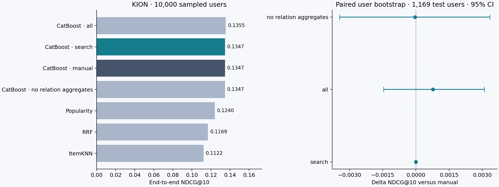

# Автоматический поиск временных признаков для рекомендаций KION

## Результат

Полный эксперимент выполнен на **10,000 случайных пользователях**, сохранены все **54,198** их исходных записей. На тесте **1,169** пользователей с известной историей и хотя бы одним будущим новым объектом. Все значения ниже получены кодом; незавершённые прогоны сюда не попадают.

Поиск выбрал группы **ни одной: оставлен ручной baseline**. Разность search − manual: **+0.00000 NDCG@10** (+0.00% относительно baseline), парный 95% CI **[+0.00000; +0.00000]**. Поиск не принял ни одной группы. Auto совпадает с manual по конструкции; нулевая разность и интервал [0, 0] в этом случае не являются свидетельством эквивалентности двух разных моделей. Самостоятельное сравнение автоматической генерации с ручным baseline даёт контроль all_features.



## Задача и данные

Предсказываем множество новых для пользователя фильмов/сериалов, чья **последняя зарегистрированная дата просмотра** приходится на следующую неделю. Это исследование ранжирования неявного отклика, а не CTR. Не наблюдавшийся в будущем кандидат — unobserved, а не доказанный отрицательный интерес.

Использован [официальный KION](https://github.com/irsafilo/KION_DATASET), commit `f69775be31fa5779907cf0a92ddedb70037fb5ae`, полный `data_original.zip`. В исходнике 5,476,251 строк. Отдельный `interactions.csv.zip` в этом commit обрезан до 50 MiB и заканчивается неполной строкой; он не используется. Период фактических данных: 13.03–22.08.2021. Год в описании репозитория не заменяет аудит загруженных данных.

Выборка равномерна по уникальным пользователям таблицы взаимодействий, seed 2026; после выбора оставлены все строки этих пользователей. Фильтрации по будущей активности при сэмплировании нет. Список ID и SHA-256 источника сохранены в `evidence/`. В выборке 0 повторных строк пары user–item.

KION хранит `last_watch_dt`, `total_dur`, `watched_pct` для пары. Нельзя восстановить атомарные события и исторические значения накопленной длительности. Поэтому `total_dur` и `watched_pct` исключены полностью. Запись с будущей последней датой недоступна прошлому срезу, даже если фактический ранний просмотр мог существовать. Это ограничение реконструкции истории, которое кодом исправить нельзя.

Статические метаданные считаются доступными и неизменными; версии на прошлые даты отсутствуют. Причинный эффект рекомендаций, вероятность клика и online-эффект по этим данным не оцениваются.

## Временной протокол

| fold | cutoff | end_exclusive | history_rows | warm_active_users | positive_candidates | cold_item_targets |
| --- | --- | --- | --- | --- | --- | --- |
| train_0 | 2021-07-05 00:00:00 | 2021-07-12 00:00:00 | 28264 | 886 | 925 | 261 |
| train_1 | 2021-07-12 00:00:00 | 2021-07-19 00:00:00 | 31380 | 832 | 934 | 254 |
| train_2 | 2021-07-19 00:00:00 | 2021-07-26 00:00:00 | 34736 | 886 | 1002 | 180 |
| train_3 | 2021-07-26 00:00:00 | 2021-08-02 00:00:00 | 38191 | 958 | 1019 | 221 |
| search | 2021-08-02 00:00:00 | 2021-08-09 00:00:00 | 41900 | 1040 | 1099 | 211 |
| confirm | 2021-08-09 00:00:00 | 2021-08-16 00:00:00 | 45678 | 1073 | 1116 | 246 |
| test | 2021-08-16 00:00:00 | 2021-08-23 00:00:00 | 49826 | 1169 | 1242 | 231 |

История среза строго `timestamp < cutoff`, метки — `[cutoff, cutoff + 7 days)`. Недели меток не пересекаются. Окно признака W включает `[cutoff − W, cutoff)`, однодневная точность источника сохраняется. Будущие записи не участвуют ни в популярности, ни в графе, ни в профилях.

Первые 4 среза обучают модель. На `search` выбираются глубина ручного baseline, число деревьев каждого варианта и группы автопризнаков. Сетка глубин: [5, 7]; максимум 350 деревьев, шаг проверки 25. Используется собственная end-to-end NDCG с полным знаменателем, а не встроенная NDCG только внутри кандидатов.

После поиска записан `frozen_recipe.json`, его SHA-256 **`06c12d5f31f1128641c02c1189a84b617f6d0cb0cb7e955379f2d8f3bb6f5724`**. Для независимой проверки модели переобучаются на train + search и оцениваются на `confirm`. Для финала — на train + search + confirm с неизменными параметрами. `confirm` не выбирает победителя или дополнительные признаки. Метки и кандидаты `test` материализуются только после фиксации рецепта и независимой проверки. После просмотра теста рецепты не меняются.

Пользователь включён в ranking-оценку, если имеет хотя бы одну историческую запись и будущий новый объект. Генератор сначала строит кандидатов для **всех** исторических пользователей, не принимая меток на вход. Фильтр по активности применяется затем для экономии расчёта признаков и определения измеримой популяции. Холодные пользователи исключены и учитываются аудитом: на тесте всего 1714 будущих пользователей, из них 1169 тёплых. Метрики не описывают всех зарегистрированных пользователей.

## Кандидаты и сильный baseline

Общий каталог — объекты хотя бы с одной исторической записью в пользовательской выборке. В каждом срезе исключаются уже просмотренные пары. До 80 объектов из каждого источника: популярность с half-life 7 дней; ItemKNN (cosine, shrinkage `c/(c+10)`, до 50 соседей); косинусная жанровая близость, умноженная на сглаженную популярность. Нулевой сигнал не номинирует кандидата. Итоговый список до 120 объектов выбран reciprocal rank fusion `sum(1/(20+rank))`; ties разрешаются по item ID. Граф и профили используют последние 90 дней, до 50 последних записей пользователя, веса профиля имеют half-life 30 дней.

Положительные объекты из будущего **не добавляются** в кандидаты. Для всех сравниваемых методов кандидаты совпадают побитово. Popularity, ItemKNN и RRF — способы упорядочить этот же набор, не отдельный эксперимент с другим retrieval.

CatBoostRanker обучается с `YetiRank:mode=NDCG;top=10`, learning rate 0.05, L2=5, CPU. Он использует категориальные характеристики пользователя/объекта, год выпуска, retrieval scores/source flags, давность активности и ручные агрегаты в окнах 7, 30 дней и по всей истории. Косвенные связи: жанры, режиссёры, страны, тип контента; статистики sum, max и сглаженная доля истории `sum / max(user_mass, 1)`. В этих агрегатах масса многозначной записи поровну распределяется между её категориями до применения временного ядра. Прямые счётчики user–item равны нулю в задаче новых объектов и не добавляются. ID не подаются как признаки. Запросы с постоянной меткой исключены только из обучения: ранжирующий градиент в них отсутствует; оценка сохраняет пользователей без найденных положительных кандидатов.

| method | features | depth | trees |
| --- | --- | --- | --- |
| manual | 71 | 7 | 350 |
| auto | 71 | 7 | 350 |
| all_features | 236 | 7 | 350 |
| no_relations | 35 | 7 | 325 |

Для manual, auto, all_features лучший checkpoint достиг верхней границы бюджета деревьев. Эксперимент сравнивает методы при этом ограниченном бюджете; он не устанавливает максимально достижимое качество CatBoost.

## Исследовательский метод

Автоматическое следование связям между таблицами и композиция агрегатов известны как [Deep Feature Synthesis (Kanter & Veeramachaneni, 2015)](https://groups.csail.mit.edu/EVO-DesignOpt/groupWebSite/uploads/Site/DSAA_DSM_2015.pdf). В [Featuretools](https://docs.featuretools.com/en/stable/getting_started/handling_time.html) временная доступность задаётся cutoff time и training window. Здесь реализован небольшой специализированный вариант этой идеи: фиксированные пути, явная граница `< cutoff`, поиск временных kernels и групповой отбор под ranking-метрику. Featuretools не используется как зависимость или экспериментальный конкурент; превосходство над DFS не проверяется.

Разделение подбора и внешней оценки связано с риском переобучения критерия выбора, описанным [Cawley & Talbot, 2010](https://www.jmlr.org/beta/papers/v11/cawley10a.html). Это обоснование протокола, а не утверждение, что одна контрольная неделя устраняет весь selection bias.

Проверяем гипотезу: фиксированные человеческие окна 7/30/all можно улучшить автоматическим выбором temporal kernels поверх того же relational grammar. Это ограниченный воспроизводимый поиск признаков, без заявления об алгоритмической новизне или полном AutoML.

Грамматика: сущность user/item либо путь user → просмотренный item → значение категории ← candidate item; ядро прямоугольного окна или экспоненциального затухания; агрегаты count/sum/max/share. Ручной baseline содержит 71 признак при конфигурации по умолчанию; один дополнительный kernel даёт 15 колонок. Список окон поиска [2, 3, 5, 10, 14, 21, 45, 60], half-lives [3, 10, 30]. Каждая группа использует все объявленные типы связей; топология связей и вид агрегаций здесь заданы человеком.

Жадный forward search: на каждом шаге проверить каждую оставшуюся группу, добавить лучшую при приросте NDCG не меньше 0.0005, максимум 2 добавления. Пустой выбор допустим. Никаких решений по test. Глубина для поиска наследуется от baseline; у каждого варианта своё число деревьев по search. История всех 15 запусков опубликована в `evidence/search_trials.json`. Один seed используется для поиска, 3 заранее выбранных seed — для confirm/test. Это снижает стоимость, но оставляет риск переобучения на seed и одну search-неделю.

Восемь лучших проверок на search (это данные подбора, не независимая оценка):

| trial | ndcg | iterations | depth | features | seconds |
| --- | --- | --- | --- | --- | --- |
| manual_depth7 | 0.14766 | 350 | 7 | 71 | 28.04380 |
| step1/window45 | 0.14754 | 300 | 7 | 86 | 26.24845 |
| step1/decay10 | 0.14738 | 350 | 7 | 86 | 26.64357 |
| step1/decay3 | 0.14705 | 300 | 7 | 86 | 26.80885 |
| all_features | 0.14691 | 350 | 7 | 236 | 35.70507 |
| step1/window3 | 0.14687 | 325 | 7 | 86 | 25.49793 |
| step1/window2 | 0.14660 | 300 | 7 | 86 | 26.48623 |
| step1/window5 | 0.14658 | 300 | 7 | 86 | 25.50350 |

Два контроля: `all_features` добавляет все доступные kernels и проверяет, нужен ли отбор; `no_relations` убирает ручные агрегаты косвенных связей, сохраняя общий retrieval и его жанровый score. Это абляция агрегатов, не полное отключение контентной информации. Вычислительный бюджет поиска больше двух запусков настройки baseline и показан явно.

## Итоговые метрики

| method | ndcg@10 | recall@10 | map@10 | hit_rate@10 | candidate_recall | oracle_ndcg | NDCG seed std |
| --- | --- | --- | --- | --- | --- | --- | --- |
| popularity | 0.12404 | 0.19667 | 0.08270 | 0.31480 | 0.44903 | 0.49531 | 0.00000 |
| item_knn | 0.11221 | 0.16394 | 0.07687 | 0.27716 | 0.44903 | 0.49531 | 0.00000 |
| rrf | 0.11687 | 0.19173 | 0.07407 | 0.32506 | 0.44903 | 0.49531 | 0.00000 |
| manual | 0.13470 | 0.20672 | 0.09126 | 0.34132 | 0.44903 | 0.49531 | 0.00051 |
| auto | 0.13470 | 0.20672 | 0.09126 | 0.34132 | 0.44903 | 0.49531 | 0.00051 |
| all_features | 0.13546 | 0.21047 | 0.09099 | 0.34816 | 0.44903 | 0.49531 | 0.00021 |
| no_relations | 0.13465 | 0.21143 | 0.09033 | 0.34731 | 0.44903 | 0.49531 | 0.00035 |

Основная метрика — macro NDCG@10 с бинарной релевантностью. IDCG использует **все** будущие новые объекты пользователя, включая не попавшие в кандидаты и холодные объекты. Recall делится на всё множество будущих целей. MAP использует знаменатель `min(K, number of relevant items)`. У пользователя без retrieved positives все эти метрики нулевые. `candidate_recall` показывает ограничение retrieval, `oracle_ndcg` — верхнюю границу NDCG при идеальном порядке текущих кандидатов.

Числа CatBoost — средние метрики отдельных seed [17, 42, 73], не ансамбль предсказаний. Seed std — разброс NDCG между обучениями, не доверительный интервал. Candidate AUC есть в сыром JSON как вспомогательная диагностика; LogLoss не приводится, поскольку ranker не выдаёт калиброванную вероятность отклика и отрицательные примеры не являются подтверждёнными отказами.

Независимая неделя `confirm`:

| method | ndcg@10 | recall@10 | map@10 |
| --- | --- | --- | --- |
| popularity | 0.14655 | 0.22008 | 0.10157 |
| item_knn | 0.12976 | 0.18481 | 0.09145 |
| rrf | 0.13211 | 0.20837 | 0.08677 |
| manual | 0.15724 | 0.23283 | 0.10910 |
| auto | 0.15724 | 0.23283 | 0.10910 |
| all_features | 0.15584 | 0.22777 | 0.10857 |
| no_relations | 0.15219 | 0.22583 | 0.10457 |

Парный bootstrap: сначала усреднить метрику каждого пользователя по seed, затем 3000 раз с возвращением выбирать пользователей. Интервалы условны на этой выборке, периоде, кандидатах и обученных моделях; это не доказательство обобщения на всех клиентов. Основное заранее заданное сравнение — auto против manual; остальные интервалы описательные, поправка на множественные сравнения не применяется.

| method | delta NDCG | CI low | CI high |
| --- | --- | --- | --- |
| auto | 0.00000 | 0.00000 | 0.00000 |
| all_features | 0.00077 | -0.00146 | 0.00309 |
| no_relations | -0.00004 | -0.00344 | 0.00334 |

## Разбор результата

Поиск не принял ни одной группы. Auto совпадает с manual по конструкции; нулевая разность и интервал [0, 0] в этом случае не являются свидетельством эквивалентности двух разных моделей. Самостоятельное сравнение автоматической генерации с ручным baseline даёт контроль all_features. Относительное изменение auto: +0.00%. Выбор групп нужно оценивать совместно с переносом на confirm, а не только с максимумом search. Победа на search после нескольких проб сама по себе не подтверждает гипотезу.

Длина доступной истории:

| method | history | users | ndcg@10 | recall@10 | mean_future_targets | candidate_recall | oracle_ndcg |
| --- | --- | --- | --- | --- | --- | --- | --- |
| manual | 1 record | 171 | 0.17111 | 0.24496 | 2.15789 | 0.49697 | 0.52810 |
| manual | 2–4 records | 309 | 0.15228 | 0.24002 | 2.40777 | 0.50457 | 0.54729 |
| manual | 5+ records | 689 | 0.11777 | 0.18229 | 2.97097 | 0.41222 | 0.46385 |
| auto | 1 record | 171 | 0.17111 | 0.24496 | 2.15789 | 0.49697 | 0.52810 |
| auto | 2–4 records | 309 | 0.15228 | 0.24002 | 2.40777 | 0.50457 | 0.54729 |
| auto | 5+ records | 689 | 0.11777 | 0.18229 | 2.97097 | 0.41222 | 0.46385 |

У retrieval средний recall 0.4490, oracle NDCG 0.4953. Холодных объектов среди тёплых пользовательских целей: 231/3160. Эти цели остаются в знаменателях. При малом числе пользователей глобальная популярность и граф шумнее, а каталог меньше; усовершенствование ranker не исправляет отсутствующие кандидаты.

Топ-15 признаков auto, средняя CatBoost PredictionValuesChange importance:

| feature | importance |
| --- | --- |
| retrieval_rrf | 12.054 |
| retrieval_rank | 8.608 |
| item_share_window7 | 7.209 |
| item_velocity_7 | 6.939 |
| retrieval_cf | 5.921 |
| ui_countries_share_all | 5.842 |
| item_count_window7 | 5.244 |
| ui_content_type_share_all | 4.644 |
| item_age_max | 3.085 |
| ui_content_type_share_window30 | 2.957 |
| ui_countries_max_all | 2.111 |
| ui_countries_max_window30 | 2.100 |
| retrieval_pop | 2.017 |
| ui_countries_share_window30 | 1.957 |
| ui_countries_sum_window30 | 1.864 |

Importance описывает использование признака моделью, не причинный эффект. Соседние окна сильно коррелированы; вывод о необходимости компонента опирается на абляции, не только на importance.

## Затраты и масштабируемость

Сумма измеренных этапов: **1590.5 с**; поиск и контрольные настройки: **402.1 с**; максимум sampled process RSS: **4077.7 MiB**. Внутри прогона этапы последовательны, 12 CPU-потоков, без GPU. Основной прогон и репликация частично выполнялись одновременно: wall time отражает конкуренцию за ресурсы и не является изолированным hardware benchmark. Время включает загрузку/проверку данных; отдельные fit-этапы включают prediction, запись модели и importance. RSS опрашивается каждые 0,2 с, краткие пики могут быть пропущены. Полное окружение и длительности каждого этапа — в `evidence/`.

При N исторических записей, C кандидатных строках и G kernels агрегаты стоят примерно O(G·(N + C·число значений категорий)); текущая pandas-реализация заново разворачивает категории каждого kernel. Поиск требует до O(steps·groups) обучений. Самая опасная часть масштабирования — item–item произведение: до O(sum(history_length²)) до pruning; ограничение 50 записей снижает эту стоимость. Жанровые scores могут стать плотными, а retrieval здесь сортирует каталог для каждого пользователя. Этот reference implementation рассчитан на десятки тысяч пользователей, не на миллиарды событий. Для промышленного масштаба нужны разреженный top-K без полной сортировки, ANN, инкрементальные агрегаты и распределённый feature store. Линейный прогноз времени на миллиарды по этому прогону был бы необоснованным.

## Ограничения и следующий эксперимент

Одна пользовательская выборка и один финальный временной интервал; короткие истории KION; last-watch вместо атомарных событий; неизвестный exposure; неизменность метаданных лишь предположение. Тест уже открыт: изменение методов по этим числам потребует нового отложенного периода или другого датасета.

Следующая заранее фиксируемая проверка: несколько user-sample seeds и больший масштаб, несколько внешних rolling test-недель, затем Yambda с сохранением всей истории выбранных пользователей. Чтобы проверить необходимость обучаемого представления, можно добавить историю с learnable decay или sequence encoder, сохраняя тот же протокол доступной информации. Эти эксперименты здесь не выдаются за выполненные.

## Воспроизведение

Из корня репозитория:

```powershell
uv sync --locked --extra dev
uv run --locked pytest -q
uv run --locked rec run --config configs/main.json --output runs/reproduction
uv run --locked rec report --output runs/reproduction --report-dir reports/reproduction
```

Для быстрого smoke-run: `configs/pilot.json`. Каталог запуска не перезаписывается. `runs/` и `data/` исключены из git; полный компактный набор доказательств этого результата находится в `evidence/`. Он позволяет независимо пересчитать средние, интервалы и сопоставить конфигурацию без публикации исходного датасета. Полные predictions и `.cbm` сохраняются в локальном `runs/.../test/`.

## Источники

- [Petrov et al., MTS Kion Implicit Contextualised Sequential Dataset, 2022](https://arxiv.org/abs/2209.00325).
- [Официальный репозиторий KION, фиксированный commit](https://github.com/irsafilo/KION_DATASET/tree/f69775be31fa5779907cf0a92ddedb70037fb5ae).
- [CatBoost: ranking objectives, YetiRank mode NDCG](https://catboost.ai/docs/en/concepts/loss-functions-ranking).
- [Kanter & Veeramachaneni, Deep Feature Synthesis, 2015](https://groups.csail.mit.edu/EVO-DesignOpt/groupWebSite/uploads/Site/DSAA_DSM_2015.pdf).
- [Cawley & Talbot, On Over-fitting in Model Selection, JMLR 2010](https://www.jmlr.org/beta/papers/v11/cawley10a.html).
- [Yambda: официальный dataset card](https://huggingface.co/datasets/yandex/yambda) — направление следующей проверки, в текущем результате не используется.
