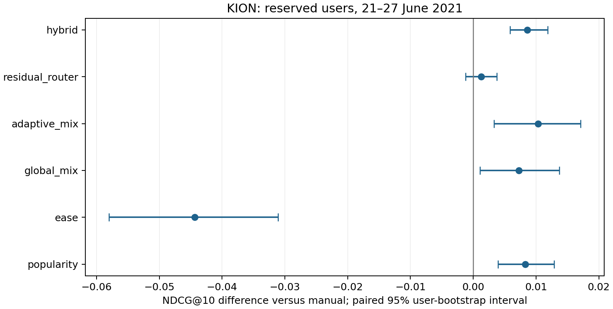

# Обученные отношения вместо новых ручных окон

На новом внешнем периоде и непересекающейся user-выборке заранее выбран **hybrid**. Его разность с ручным CatBoost: **+0.00860 NDCG@10 (+3.71%)**, парный 95% CI **[+0.00584; +0.01188]**. Парный интервал разности выше нуля на этом внешнем срезе. Это один сервис и одна внешняя неделя; вывод о превосходстве на других данных не следует автоматически.

**Сильный простой контроль меняет интерпретацию:** popularity получила 0.24000. Hybrid − popularity = +0.00033, описательный 95% CI [-0.00491; +0.00545]. Превосходство над популярностью не установлено. Выбранный в августе manual плохо перенёсся на июнь; называть его сильнейшим baseline этого периода нельзя. Результат подтверждает улучшение конкретного замороженного GBDT, а не победу над лучшим доступным алгоритмом.

## Вопрос и исследовательский вклад

Первый этап с двумя 10-тысячными выборками не подтвердил выигрыш перебора временных окон: [предыдущий разбор](../STUDY.md). Здесь меняем сам способ представления user–item связи: обучаем item–item коэффициенты EASE на прошлой матрице взаимодействий. Шесть score-колонок описывают две регуляризации и три масштаба истории, вместо добавления десятков count-агрегатов.

Между этапами изменены кандидаты, число обучающих срезов и бюджет деревьев. Разность результатов первого и второго этапов нельзя целиком приписать EASE или считать прямым сравнением автоматического поиска окон с обученными представлениями. Основное контролируемое сравнение — hybrid/manual внутри второго этапа.

Дополнительно реализована собственная гипотеза: небольшой residual router выбирает временную коррекцию сильного замороженного GBDT по его out-of-time прогнозам. Сравниваем её с глобальной смесью, adaptive-смесью без baseline и простым hybrid. Обучение gate, EASE и temporal mixtures известны; мировой приоритет комбинации не установлен. [Литературная карта](../../docs/LITERATURE.md) отделяет заимствования, реализацию и ограничения новизны.

## Внешняя проверка — основное сравнение

| Метод | NDCG@10 | Recall@10 | MAP@10 | Δ NDCG, 95% CI |
| --- | --- | --- | --- | --- |
| manual | 0.23173 | 0.33843 | 0.16863 | — |
| hybrid | 0.24033 | 0.35207 | 0.17488 | +0.00860 [+0.00584; +0.01188] |
| residual_router | 0.23298 | 0.34438 | 0.16823 | +0.00125 [-0.00123; +0.00378] |
| adaptive_mix | 0.24206 | 0.34628 | 0.17827 | +0.01033 [+0.00333; +0.01709] |
| global_mix | 0.23901 | 0.34427 | 0.17494 | +0.00728 [+0.00109; +0.01369] |
| ease | 0.18739 | 0.27597 | 0.13426 | -0.04434 [-0.05799; -0.03107] |
| popularity | 0.24000 | 0.33781 | 0.17968 | +0.00827 [+0.00396; +0.01287] |



Primary сравнение — только выбранный до внешних метрик hybrid против manual. Остальные интервалы — описательные, без поправки за множественные сравнения. Метрики manual/hybrid/residual усредняют три отдельных обучения с seed 17/42/73, а не прогнозы ансамбля. Глобальный/adaptive gate обучен один раз на OOF teacher seed 17; повтор его одинакового прогноза три раза не даёт трёх независимых fits. Residual использует тот же gate и разные baseline offsets.

| method | seed | ndcg@10 | recall@10 |
| --- | --- | --- | --- |
| hybrid | 17 | 0.24282 | 0.35520 |
| hybrid | 42 | 0.23865 | 0.34855 |
| hybrid | 73 | 0.23953 | 0.35247 |
| manual | 17 | 0.23383 | 0.34084 |
| manual | 42 | 0.23203 | 0.33704 |
| manual | 73 | 0.22932 | 0.33740 |
| residual_router | 17 | 0.23444 | 0.34524 |
| residual_router | 42 | 0.23235 | 0.34300 |
| residual_router | 73 | 0.23214 | 0.34490 |

Самая высокая точечная оценка здесь у adaptive_mix. Он не был выбран по search, поэтому его нельзя задним числом назначать подтверждённым победителем. Для переноса этого выбора нужен ещё один внешний test.

Bootstrap: сначала усреднение метрик каждого пользователя по seed, затем 3 000 парных resamples user ID, RNG 314159. Интервал условен на данных, каталоге и обученных моделях; обучение и item statistics внутри bootstrap не пересчитываются. Три model seeds не заменяют новые периоды или user samples.

## Как защищён новый тест

Сначала зарезервированы 10 000 user ID с seed 314159 вне обеих выборок первого этапа. Затем на старой development-выборке выбирались параметры. Рецепт зафиксирован SHA-256 `06992b98fbd1f6a6487cd94afb11ce89dd903073e239ca9615b0be96a30fa128` до построения внешних targets.

Внешние модели переобучены с нуля. Supervised-срезы development-пользователей: 17, 24, 31 мая, 7 и 14 июня. Начальный teacher использует первый срез; OOF прогноз следующего среза получается только после обучения на предыдущих. Тест: 21–27 июня 2021, exclusive end 28 июня. История всегда строго до cutoff, включая неразмеченную историю зарезервированных пользователей; она одинаково доступна всем методам.

Рецепт выбран в августе, внешний период — июнь. Это **ретроспективная проверка переноса на новые targets и новых пользователей**, а не симуляция разработки алгоритма до наступления июня. Исходный CSV целиком читается при загрузке; будущие строки отделяются до расчёта истории. Внешние метки не участвуют в признаках, кандидатах, обучении и выборе параметров основного внешнего сравнения. Отдельная полнопопуляционная feasibility-проба использует историю до августа, в том числе более поздние записи зарезервированных пользователей; её матрицы/прогнозы не передаются внешним моделям. Поэтому изоляция здесь относится к целевой оценке и основному пайплайну, а не к физическому отсутствию доступа к исходному CSV на всём исследовательском этапе.

Перед построением внешних targets сохранены прогнозы всех методов для 5,185 тёплых зарезервированных пользователей, 920,409 пар. Оценка затем условна на наличии будущего novel target: 834 пользователей, 2,228 целей. Нулевой label — unobserved interaction, а не отказ после показа. Не измеряем популяционный CTR/LogLoss.

## Разделение retrieval и ranking

Для основного сравнения все методы получают один union: исходные RRF120 (популярность, ItemKNN, жанры) плюс EASE top120. Получается до 240 кандидатов; EASE-score не добавляется в ручные retrieval-признаки. Исторический каталог общий; будущие positives не подмешиваются. Пропущенные и cold цели входят в знаменатель Recall и IDCG.

Candidate Recall — 0.6107, oracle NDCG@10 — 0.6550. Вне исторического каталога 261 / 2228 целей. Oracle — идеальная перестановка имеющихся кандидатов, не качество обученной модели.

Вторичный контроль ниже повторно обучает модели на исходных RRF120 при совпадающих параметрах и seed 17. Это разные candidate policies; их нельзя использовать как основное сравнение представлений. Параметры не перенастраивались под меньший пул.

| Метод, seed 17 | Кандидаты | NDCG@10 | Candidate Recall | Oracle NDCG |
| --- | --- | --- | --- | --- |
| manual | original RRF120 | 0.23490 | 0.57852 | 0.62340 |
| manual | union ≤240 | 0.23383 | 0.61074 | 0.65504 |
| hybrid | original RRF120 | 0.23955 | 0.57852 | 0.62340 |
| hybrid | union ≤240 | 0.24282 | 0.61074 | 0.65504 |

## Выбор и перенос параметров

CatBoost manual — 71 ручной признак, hybrid — те же 71 плюс шесть EASE-колонок. Одинаковый бюджет: глубины 5/7, максимум 600 деревьев, checkpoint 25, learning rate 0,05, L2=5. Выбрано manual depth=7, trees=275; hybrid depth=7, trees=575. EASE: B = −P / diag(P), P = (XᵀX + lambda I)⁻¹, diag(B)=0; бинарная X содержит только прошлые записи. Полураспады меняют профиль пользователя на inference, а не матрицу обучения X.

Router использует шесть EASE, три retrieval scores и нулевой эксперт. Контекст: объём/давность/скорость активности и разногласие экспертов. Scores нормализуются внутри запроса; loss — listwise cross-entropy с множителем logits 3 (temperature 1/3), L2 0,01/0,1. Residual scale выбирался из 0,25/0,5/1. Количество trials основного поиска — 14; все trials и статусы оптимизатора доступны в evidence.

| Метод | Search 2 августа | Confirm 9 августа | Exploratory 16 августа | External 21 июня |
| --- | --- | --- | --- | --- |
| manual | 0.14620 | 0.15683 | 0.13487 | 0.23173 |
| hybrid | 0.15217 | 0.15702 | 0.14035 | 0.24033 |
| residual_router | 0.14661 | 0.15745 | 0.13472 | 0.23298 |
| adaptive_mix | 0.14240 | 0.15341 | 0.12707 | 0.24206 |
| global_mix | 0.14120 | 0.15229 | 0.12655 | 0.23901 |

Search использует seed 17; confirm — только seed 17; exploratory/external — среднее 17/42/73. Они имеют разные обучающие истории и популяции, поэтому таблица не выделяет чистый эффект временного сдвига. Августовский exploratory test уже был открыт первым этапом и не служит новым подтверждением. Confirm не корректировал рецепт.

Предварительные пробы на search: EASE lambda=1000/h30 на старых кандидатах 0,13394; random walk RP3beta 0,08196; hybrid с четырьмя train-срезами и потолком 350 деревьев 0,15085. Это отличающиеся бюджеты/пулы, не ещё одно честное primary сравнение. Полные локальные пробы сохранены отдельно.

## Анализ

| cohort | users | history | targets | manual | hybrid | residual | delta | candidate_recall |
| --- | --- | --- | --- | --- | --- | --- | --- | --- |
| 1 | 150 | 1.00000 | 2.02000 | 0.28265 | 0.29628 | 0.28330 | 0.01363 | 0.70341 |
| 2–4 | 270 | 2.74074 | 2.27037 | 0.27925 | 0.29004 | 0.28113 | 0.01079 | 0.66137 |
| 5+ | 414 | 16.99275 | 3.16908 | 0.18229 | 0.18765 | 0.18335 | 0.00536 | 0.54414 |

Когорты определены длиной доступной истории. Состав пользователей, число целей и candidate recall меняются одновременно: разности между строками не доказывают причинный эффект длины истории.

| feature | importance |
| --- | --- |
| item_share_window7 | 11.34748 |
| item_velocity_7 | 10.62136 |
| ease_l100_h30 | 6.18764 |
| retrieval_rank | 6.00514 |
| release_year | 5.60975 |
| item_age_mean | 5.15334 |
| retrieval_rrf | 4.95699 |
| retrieval_content | 3.54584 |
| ease_l100_hNone | 3.49320 |
| ui_content_type_share_all | 2.83696 |
| item_age_max | 2.61097 |
| ui_countries_share_window30 | 2.52867 |

Importance — средний PredictionValuesChange трёх hybrid-моделей, не причинный вклад. Полные importance и распределения gate weights доступны в evidence.

Внешний residual gate в среднем назначил temporal EASE-экспертам 4.5% массы, жанровому retrieval 29.2%, нулевому эксперту 65.0%. Это наблюдаемое поведение обученного gate: временные эксперты не стали основным источником коррекции. Средние gate weights не являются независимой атрибуцией качества.

Возможные ограничения router: коррелирующие эксперты, convex weights, небольшой контекст и несовпадение cross-entropy с NDCG. Чтобы установить конкретную причину, нужны дополнительные абляции на новом holdout. Мы не объясняем результат одной неподтверждённой историей.

## Вычислительная цена и границы

| Фаза | Измеренные участки, с | Peak process RSS, MiB |
| --- | --- | --- |
| development | 1321.4 | 3893.2 |
| external | 495.2 | 2810.6 |

Основная цепочка второго этапа выполнила 31 CatBoost fit: 4 HPO, 11 teacher/OOF/search-offset, 14 final manual/hybrid и 2 candidate-policy controls. Отдельно — 10 router HPO fits и 9 final gate fits; 28 EASE-факторизаций для 14 временных срезов. Предварительные пробы и первый этап не входят в эти количества. Повторное чтение OOF cache не считается новым fit.

Машина: i7-14700KF, 28 logical CPU, около 48 GiB RAM; по 12 потоков в каждом процессе, GPU не используется. Development и external частично выполнялись параллельно. Таблица суммирует измеренные участки подготовки/обучения/скоринга; часть gate fitting, записи predictions и bootstrap находится вне измеренных участков. Это не полный wall time и не изолированный hardware benchmark.

Плотный EASE хранит O(I²), факторизация требует O(I³); scorer обрабатывает каталог пачками. Проба на всей прошлой user-популяции перед 2 августа: 797 423 пользователя, 15 237 объектов, 4 266 013 связей, lambda=1000. В сохранённой пробе построение sparse-матрицы и обучение заняли 32.1 с. Она получает больше данных и не включена в основное сравнение. Для больших каталогов нужен разреженный/низкоранговый вариант и отдельная проверка качества, например SANSA; миллиарды событий этим запуском не проверены.

KION хранит последнюю дату user–item пары, не полный атомарный лог. Ранние просмотры пары с будущей last date невосстановимы. total_dur/watched_pct исключены. Исторических версий метаданных нет: предполагаем их доступность и неизменность. Оценка conditional warm-user ranking не определяет качество cold-user рекомендаций или online эффект. EASE/FEASE/LightGCN/MARS не считаются новыми методами проекта; полные нейронные модели здесь не воспроизводились.

## Воспроизведение и проверка

Из корня репозитория; ID выборок первого этапа уже включены в reports/main/evidence и reports/replication/evidence, повторно обучать первый этап не требуется:

```powershell
uv sync --locked --extra dev
uv run --locked rec download --raw data/raw
uv run --locked python scripts/research_v2.py reserve --root runs/v2-reproduction
uv run --locked python scripts/research_v2.py development --root runs/v2-reproduction
uv run --locked python scripts/research_v2.py external --root runs/v2-reproduction
uv run --locked python scripts/replay_v2.py --run runs/v2-reproduction
uv run --locked python scripts/report_v2.py --run runs/v2-reproduction --output reports/v2-reproduction
uv run --locked rec verify --report-dir reports/v2
```

`--development-run` и `--replication-run` задают папки с sample.json других воспроизведений первого этапа; по умолчанию reports/main/evidence и reports/replication/evidence. Код не перезаписывает frozen recipe и завершённый внешний test. Полные модели/predictions/cache остаются в runs; компактное evidence включает per-user результаты, ID cohort, frozen recipe, все trials, протокол, hashes и replay. Проверено 43 массивов predictions с удалённой target-колонкой, максимальная ошибка 0. Для routers query_id нужен только как граница списка кандидатов; метки он не содержит.

После открытия этой внешней оценки дальнейший подбор требует ещё одного нетронутого периода или датасета. Проверка опубликованных метрик не требует скачивания KION.
