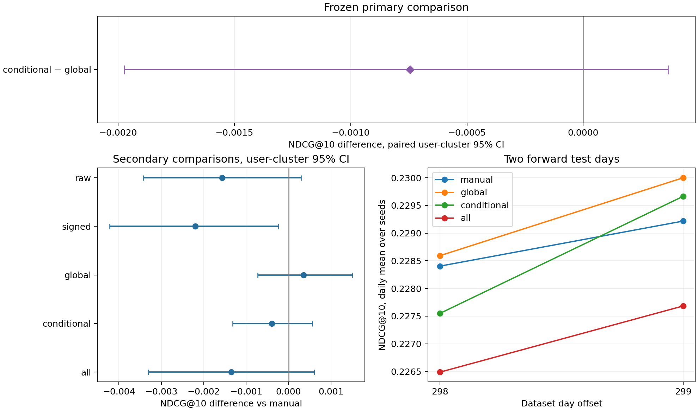
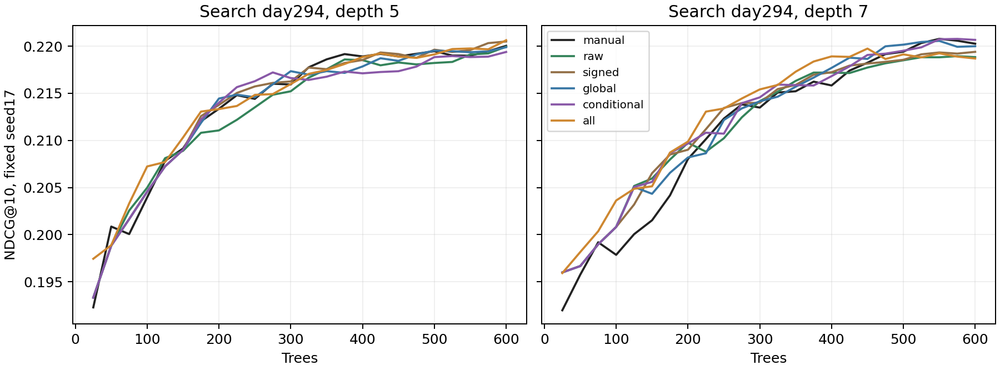
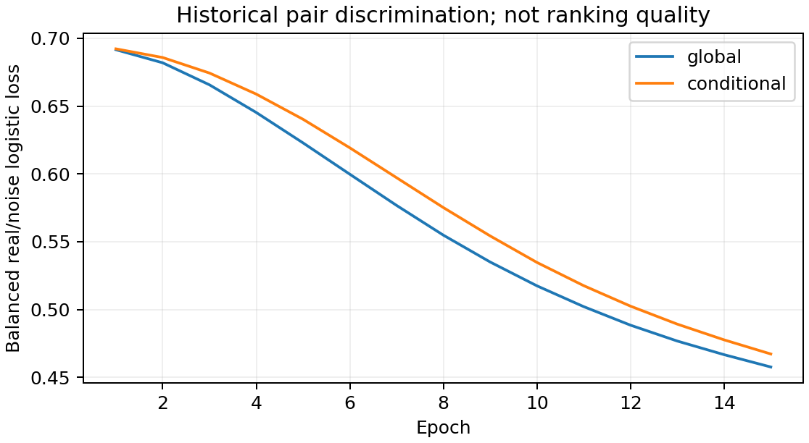

# Что остаётся от временного порядка после вычитания вкуса

На независимом от KION event log Yambda выполнено основное сравнение двух одинаковых neural encoders: **conditional user–day noise − global noise = -0.00075 NDCG@10**, парный 95% user-cluster CI **[-0.00197; +0.00037]**. Убедительный выигрыш условного фона не подтверждён: интервал включает ноль. Это не доказательство эквивалентности.

По search заранее выбран deployable variant **manual**. Лучшая точечная оценка на test — global; это описательный результат, он не меняет primary гипотезу и не выбирает модель задним числом.

## Что здесь исследуется

Второй этап на KION показал пользу EASE-признаков, но оригинальный residual router не дал убедительного выигрыша. Здесь другой источник информации: фактические соседние прослушивания, длительные истории и повторное потребление. Объём user-выборки — **4,855,816 прослушиваний**, 1 000 пользователей; все исходные строки listens этих пользователей сохранены без обрезания хронологии. Другие event types не входят в выбранную исходную таблицу.

Гипотеза: global noise позволяет узнавать устойчивые item–item ассоциации, обусловленные пользовательским вкусом, тогда как user–day noise сохраняет состав музыки одного пользователя за сутки и заставляет отличать конкретные переходы. Обе перестановки сохраняют глобальные source/target marginals: одна лишь unary popularity не различает классы. Мы учим асимметричные source/target embeddings и проверяем пользу их scores для сильного ручного GBDT. Это конкретная самостоятельная конструкция, а не заявленный мировой приоритет. [Литература и отличия](../../docs/LITERATURE_V3.md), [математический вывод и noise support](../../docs/DENSITY_RATIO.md).

Оптимальный unrestricted balanced discriminator оценивает log p(real pair)/q(noise pair). Наша rank-64 dot-модель ограничена и не имеет такой гарантии. Это NCE-style density-ratio critic без отдельного log-q correction, а не полная репликация классического density estimator. User/day не подаются в encoder: условность относится к построению noise, затем он маргинализируется. Модель не предсказывает персональную causal probability. Noise-пары не трактуются как негативные клики; совпадения с реальными парами разрешены.

## Основной результат и сильные контроли

| Метод | NDCG@10 | Recall@10 | MAP@10 | Δ vs manual, 95% CI |
| --- | --- | --- | --- | --- |
| manual | 0.21894 | 0.12960 | 0.15918 | — |
| raw | 0.21738 | 0.12832 | 0.15850 | -0.00157 [-0.00342; +0.00030] |
| signed | 0.21675 | 0.12800 | 0.15770 | -0.00220 [-0.00422; -0.00023] |
| global | 0.21929 | 0.12980 | 0.15931 | +0.00035 [-0.00073; +0.00151] |
| conditional | 0.21855 | 0.12938 | 0.15897 | -0.00040 [-0.00132; +0.00056] |
| all | 0.21759 | 0.12812 | 0.15839 | -0.00135 [-0.00331; +0.00061] |
| repeat | 0.19340 | 0.11828 | 0.14410 | -0.02555 [-0.03344; -0.01845] |
| popularity | 0.01560 | 0.00792 | 0.00599 | -0.20335 [-0.22407; -0.18258] |
| userknn | 0.03097 | 0.01673 | 0.01258 | -0.18797 [-0.20975; -0.16617] |

Основная гипотеза одна — conditional vs global. Все CI против manual вторичные, без multiplicity correction. Primary интервал условен на выборке и трёх обученных pipeline seeds; модели не переобучаются внутри bootstrap. После search-диагностики отдельно заморожено [вторичное исправление noise support](../v3_support/REPORT.md); оно не заменяет исходную гипотезу.



Модель каждого seed включает **свой encoder и свой CatBoost** с одинаковым seed 17/42/73. Это три полных retraining варианта, не три повторения одного нейронного прогноза. Графовые operators используют фиксированный null ensemble seeds 19/23. Candidate pool общий, построен encoder seed17 и не меняется между model seeds; его вариативность не покрывается CI.

Агрегация: сначала mean по model seeds внутри user–day, затем mean дней внутри пользователя, затем mean пользователей. Пустой target day не добавляет искусственный ноль. Bootstrap ресэмплирует целых пользователей с обоими их доступными днями, 3 000 resamples, RNG2028. **Overall user macro отличается от среднего двух дневных macro**, поскольку состав активных пользователей меняется. Публикуются обе таблицы, они не подменяют друг друга.

## Проверка переноса выбранных настроек

| Метод | Search day294 | Confirm day296 | Test, user macro | Depth | Trees | Features |
| --- | --- | --- | --- | --- | --- | --- |
| manual | 0.22078 | 0.24032 | 0.21894 | 7 | 550 | 69 |
| raw | 0.21995 | 0.24017 | 0.21738 | 5 | 600 | 72 |
| signed | 0.22050 | 0.23948 | 0.21675 | 5 | 600 | 72 |
| global | 0.22056 | 0.23863 | 0.21929 | 7 | 550 | 72 |
| conditional | 0.22078 | 0.23947 | 0.21855 | 7 | 575 | 72 |
| all | 0.22064 | 0.23936 | 0.21759 | 5 | 600 | 81 |

Search/confirm используют seed17. Параметры выбираются только на search. Нейронные dimension64/15epochs/lr.01/batch8192 и профили 1/24/168h зафиксированы до поиска. Каждый CatBoost получил depth5/7, максимум600 деревьев с checkpoint25, lr.05, L2=5, YetiRank NDCG top10. Если лучшая точка достигла600, это ограничение бюджета, а не доказательство сходимости.

Отдельные search scores показывают, что качество дискриминации real/noise и качество рекомендаций расходятся; они не используются вместо end-to-end selection. Все 12 HPO trajectories, включая проигравшие варианты, включены в evidence.



Линии относятся к одному search fold и seed17. Максимум такой траектории подвержен selection optimism; перенос проверяется отдельно, не оценивается доверительным интервалом по этим checkpoint.



Эти две loss-кривые решают задачи с разными noise distributions. Их абсолютные значения нельзя сравнивать как независимую оценку качества рекомендаций.

## Временная схема без утечки

Анонимизированные timestamps — секунды с точностью 5s, не индексы пятсекундных интервалов. Используем day offset от начала источника; реальных календарных дат и локальных часовых поясов нет. Последние полные сутки заканчиваются в day300. Train cutoffs286/288/290/292, search294, confirm296, **test298/299**. Каждый label horizon — одни сутки, history t < day*86 400 −1 800. Будущие item IDs/plays не входят в признаки и каталог.

На обоих test днях сперва сохранены все predictions для всех тёплых sampled users; только затем построены held-out item sets. Перед вторым test обновляются unsupervised histories/graph/embeddings по ставшим доступными событиям, но GBDT не дообучается на первом test дне. Это заранее заданная daily refresh схема, не полностью статическая двухдневная модель.

Рецепт заморожен до test: `71d7c6355ca0ba7fc354ffc5735cf8ba487ad81bd0412906e42a647429330460`. Все полные candidate/feature таблицы повторно сгенерированы с заменённым содержимым будущих событий — совпадение точное. Также удалены label и query_id из входов сохранённых rankers: 51 массивов predictions воспроизведены точно. Это проверка исполнения, не доказательство отсутствия неизвестных задержек logging.

| day | scored_users | pairs | target_users | targets | cold_item_targets | repeat_targets | novel_targets |
| --- | --- | --- | --- | --- | --- | --- | --- |
| 298 | 1000 | 297903 | 503 | 13649 | 653 | 9412 | 4237 |
| 299 | 1000 | 297829 | 500 | 14994 | 619 | 10269 | 4725 |

Label — уникальные треки, прослушанные минимум на50% в следующих сутках, повторы разрешены. Это наш фиксированный threshold >=50, который не следует путать с чужими benchmark definitions. Unobserved candidates не являются подтверждёнными отказами; CTR и online effects не измеряются. Cold/unretrieved positives остаются в Recall и IDCG, никакого positive injection нет.

## Кандидаты и ручные признаки

Общий RRF cap300 объединяет repeat, decayed global popularity, userKNN, artist affinity, raw/signed graph и оба encoders. Повторы не удаляются. Retrieval seed17 одинаков для всех. Качество learned representations сравнивается внутри одного и того же пула; «manual» также получает его общий RRF/rank, то есть использует общие номинации косвенно.

Manual содержит 69 признаков: categorical user/item/primary-artist IDs, total/positive counts за1/7/30/all по user/item/pair/user–artist, smoothed positive rates, shares, давность и исходные repeat/pop/userKNN/artist scores. Learned columns: по три масштаба каждого нового сигнала. Primary conditional/global имеют одинаковое число дополнительных колонок и одинаковый HPO budget.

Графовый контроль: C — реальные соседние positive pairs с 0<lag<=30min за последние30 дней; P — среднее двух перестановок target endpoints внутри user–day. Raw weights C/(C+5); signed weights (C−P)/(C+P+5), до64 положительных и64 отрицательных соседей. Это bounded signed association, не оценка эффекта вмешательства. Ties сортируются по item ID; delta=0 edges исключены, но пятисекундная неоднозначность ограничивает интерпретацию порядка.

### Какие сигналы использует бустинг

Топ manual-признаков по среднему CatBoost PredictionValuesChange трёх seed:

| feature | importance_percent |
| --- | --- |
| repeat_score | 11.66611 |
| ui_age_hours | 7.07293 |
| ua_share_30 | 6.18223 |
| retrieval_rrf | 4.91247 |
| retrieval_rank | 4.68589 |
| ui_share_all | 4.25778 |
| ua_share_all | 4.21560 |
| artist_score | 4.20377 |
| ui_share_7 | 3.75003 |
| ui_positive_rate_all | 3.55905 |

Суммарная доля дополнительных learned/graph колонок внутри каждого соответствующего ranker; mean/min/max по seed:

| method | mean | min | max |
| --- | --- | --- | --- |
| all | 3.18337 | 3.03763 | 3.44948 |
| conditional | 0.40669 | 0.31044 | 0.56334 |
| global | 0.68298 | 0.58888 | 0.75761 |
| raw | 1.87355 | 1.63279 | 2.17672 |
| signed | 1.04419 | 0.92743 | 1.14043 |

PredictionValuesChange описывает вариативность предсказаний обученных деревьев, не causal вклад и не прирост NDCG. Значения разных моделей имеют собственную нормировку. Для вывода о качестве используются сравнения полных моделей выше; correlated-признаки могут делить importance.

## Анализ популяций и цели

| history_cohort | users | history_rows | manual | global_nce | conditional_nce | candidate_recall |
| --- | --- | --- | --- | --- | --- | --- |
| <=1000 | 92 | 551.50000 | 0.22296 | 0.22301 | 0.21938 | 0.40817 |
| 1001–5000 | 229 | 2837.50218 | 0.20484 | 0.20529 | 0.20475 | 0.33593 |
| >5000 | 299 | 10884.62876 | 0.22851 | 0.22888 | 0.22886 | 0.31727 |

Когорты истории определены только по доступному прошлому первого test cutoff. Они различаются также активностью, количеством целей и candidate coverage; сравнение когорт не является causal эффектом длины истории.

| targets | method | ndcg@10 | recall@10 |
| --- | --- | --- | --- |
| novel | conditional | 0.00000 | 0.00000 |
| novel | global | 0.00000 | 0.00000 |
| novel | manual | 0.00000 | 0.00000 |
| organic=0 | conditional | 0.05021 | 0.02139 |
| organic=0 | global | 0.05075 | 0.02292 |
| organic=0 | manual | 0.04981 | 0.02249 |
| organic=1 | conditional | 0.31701 | 0.23262 |
| organic=1 | global | 0.31763 | 0.23259 |
| organic=1 | manual | 0.31770 | 0.23213 |
| repeat | conditional | 0.25304 | 0.16656 |
| repeat | global | 0.25372 | 0.16726 |
| repeat | manual | 0.25350 | 0.16749 |

Срезы repeat/novel и organic/non-organic описательные: R меняется, поэтому метрики между срезами нельзя сравнивать как одну задачу. Таблица усредняет отдельно дневные/seed macro; основная overall метрика выше усредняет пользователей. Organic и algorithmic множества треков могут пересекаться, если трек слушали обоими способами. Logging policy не устраняется одной лишь стратификацией.


### Ограничение открытия новых треков

После расчёта test выполнен описательный аудит сохранённых candidates и top10; параметры не менялись. Новый трек здесь означает отсутствие любых предыдущих listens этой user–item пары.

| day | evaluated_users | novel_target_users | novel_targets | reachable_novel_targets | candidate_novel_pair_share | novel_candidate_recall_user_macro |
| --- | --- | --- | --- | --- | --- | --- |
| 298 | 503 | 361 | 4237 | 183 | 0.54321 | 0.06509 |
| 299 | 500 | 372 | 4725 | 235 | 0.54807 | 0.07142 |

Более половины candidate pairs — новые для пользователя, однако большинство истинных новых треков в пул не попадает: доступны только 183 из4237 и235 из4725 целей. User-macro candidate recall новинок составляет6.5%/7.1%. Одновременно rankers почти всегда выбирают повторы: доля новых пар среди top10 составляет 0.05% у manual, 0.07% у global и 0.05% у conditional. Ни один из обученных бустингов не получил novel hit на этом test.

Здесь действуют два ограничения: низкое покрытие релевантных новинок retrieval и редкие новые экспозиции у ranker. Эти данные не устанавливают причину такого порядка или оптимальный exploration policy. Основной результат относится преимущественно к повторному потреблению; он не подтверждает качество discovery. Аудит post-test, не новая гипотеза или основание менять модель по этим метрикам.


Возможные объяснения результата: условный фон может удалить полезный стабильный вкус вместе с фоном; pair encoder ограничен rank64; target next-day отличается от соседних transitions; профиль100 событий теряет длинную историю; редкие переходы шумны. NCE взвешивает переходы, основной estimand — пользователей, поэтому активные слушатели влияют на обучение и оценку по-разному. Это гипотезы, не установленные причины. Их разделение требует новых заранее заданных контролей и ещё одного неоткрытого holdout.

## Масштаб и вычислительная цена

| Фаза | Сумма job wall seconds | Max single-process RSS MiB |
| --- | --- | --- |
| development | 4356.5 | 4180.4 |
| test | 5390.6 | 4437.0 |

Зафиксированы 48 neural fits (2 noise distributions ×3seeds ×8snapshots), по15epochs; 12 HPO CatBoost fits, 6confirm и18test fits — всего36 CatBoost fits. Прерванный технический fit и настройка окружения в эти завершённые fits не входят. CPU jobs выполнялись по два одновременно, каждый12threads; платформа Intel64 Family 6 Model 183 Stepping 1, GenuineIntel, 47.8GiB RAM. Neural training — NVIDIA GeForce RTX 4070 Ti SUPER, PyTorch2.5.1+cu121.

Таблица суммирует wall durations **завершённых перекрывающихся задач**, не elapsed experiment time. Max RSS — максимум одного процесса, не сумма всей машины. GPU peak allocated memory одного encoder: 162.1MiB, без CUDA context/reserved allocator. Сумма encoder fit+save durations из метаданных сохранённых моделей — 189.3s; она не добавляется поверх prepare. После технического возобновления часть готовых моделей бралась из кэша, поэтому эти durations не являются точным разложением заново измеренных prepare stages. Общий retrieval вычисляет все источники и для manual; эти затраты нельзя трактовать как стоимость отдельной production-модели manual.

Исторический каталог достигает 277,287 объектов. Одна плотная float32 item–item матрица потребовала бы около **286.4GiB**, без inverse/Gram temporaries. Вместо неё используются sparse observed edges и две embedding tables: при 79,851 active items около 39.0MiB параметров, без optimizer states. UserKNN материализует U×U, neural retrieval — users×active-items score blocks. Эти части ещё требуют batching/ANN для больших популяций; промышленная масштабируемость не доказана.

Neural vocabulary ограничен объектами соседних positive transitions последних30 дней; его экономия связана и с этим ограничением, не только с low rank. Полный исторический каталог остаётся общим, неизвестные encoder объекты получают score0. Hybrid также сохраняет весь CatBoost; размеры сериализованных файлов всех моделей и predictions приведены в artifact_sizes.csv. Это не измерение end-to-end serving latency.

## Данные и границы вывода

Источник HF revision dd6f3a19eef5866e346c3270e098baa641a44948; два SHA256-verified файла (listens и artist mapping), около407MB. В listens реально9 238 uid; исходная таблица вариантов округляет пользователей до10 000 и включает другие event types. Мы выбираем пользователей из наблюдаемой listens-популяции и сохраняем все строки. Yambda сама предварительно отбирает активных пользователей; вывод не относится к произвольным клиентам.

Metadata versions отсутствуют. Primary artist — minimum artist_id при нескольких авторах, что упрощает отношения. Источник — listens из варианта flat/50m, затем собственный user-level sample. Audio embeddings, likes/dislikes и большие варианты500M/5B не используются в моделях. Исторический playback outcome считается доступным по timestamp; точные delays неизвестны, gap30min не доказывает, что их нет. Наличие is_organic не обеспечивает causal identification. Один user sample и два test дня ограничивают обобщение и позволяют только условную оценку bootstrap.

KION и Yambda имеют разные labels, histories, repetition regime, candidate catalogs и популяции. Их абсолютные NDCG не сравниваются как прирост одного алгоритма. Предыдущие отрицательные результаты остаются в [отчётеv2](../v2/REPORT.md).

## Воспроизведение

```powershell
uv sync --locked --extra dev --extra neural
uv run --locked --extra neural python scripts/run_v3.py --root runs/v3-reproduction --report-dir reports/v3-reproduction
uv run --locked rec verify --report-dir reports/v3
uv run --locked rec verify --report-dir reports/v3_support
```

PyTorch extra использует доступный CUDA или CPU backend. Для совпадения с опубликованным runtime нужна PyTorch2.5.1+cu121 CUDA build; wheel выбирается по [официальной инструкции PyTorch](https://pytorch.org/get-started/previous-versions/). CPU training допустим для воспроизведения процедуры, но exact weights/метрики между backend не обещаются. В локальном исследовании использована отдельная .venv-neural с имеющимся CUDA runtime и core dependencies из uv.lock. Сырые данные/модели/cache остаются в runs/data; их hashes и все losses/seed-day metrics включены в evidence.

Внешний test теперь открыт. Новые гиперпараметры по его результатам не подбираются; для следующей проверки нужен новый период или новый user sample, заранее исключённый из обучения и выбора.
