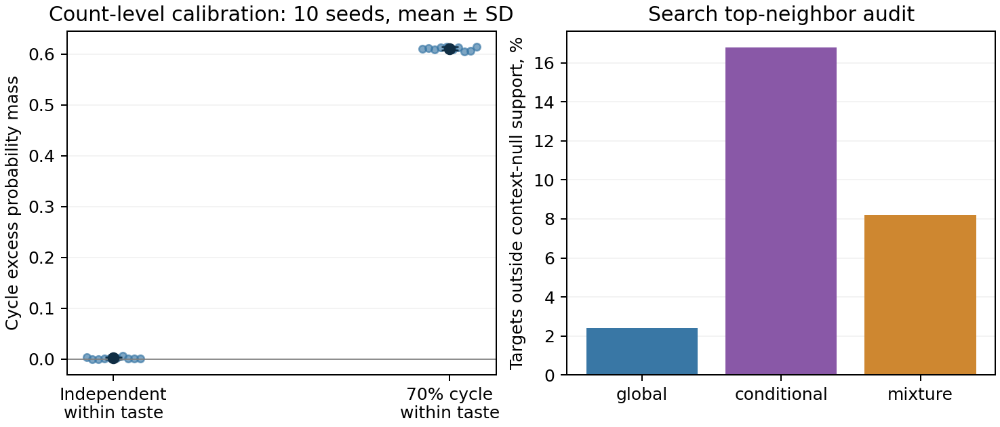

# Исправление поддержки noise distribution

Это **вторичное дополнение, предложенное после анализа search**, до открытия test298/299. Основное сравнение conditional/global из [третьего этапа](../v3/REPORT.md) не меняется и публикуется независимо от результата исправления.

Замороженная коррекция выбрала half-life 1h, alpha=0.1; search NDCG@10 0.22114. На внешних днях: manual 0.21894, support-mixture correction 0.21798, **разность -0.00096, описательный 95% CI [-0.00301; +0.00101]**. Убедительный внешний выигрыш не подтверждён. Это не новое подтверждающее primary сравнение и не основание выбрать лучшего метода по test.

## Диагноз до открытия test

На search-переходах 93.4% global-noise пар находятся вне поддержки context-preserving null. При p=q_context=0 loss не определяет logit этой пары; parameter sharing/regularizer не гарантируют правильный порядок. Нулевой score такой пары способен оказаться выше отрицательного ratio наблюдаемого перехода.

Существует и более общий риск: conditional null удаляет полезный вкус вместе с неинтересующим исследователя фоном. Положительный результат mixture не выделяет эти две причины отдельно, потому что он одновременно меняет noise support и сохраняемые предпочтения.

[Вывод](../../docs/DENSITY_RATIO.md) даёт `E[C_null(i,j)]=sum_z a_zi*b_zj/n_z` и optimum balanced critic `log(p/q)`. Для `q_mix=.5*q_global+.5*q_context` выполняется `q_mix>=.5*q_global`. Это обеспечивает noise support на поддержке observed source/target marginals, не гарантирует качество рекомендации и не является новой общей теоремой.

## Контролируемая синтетика

Два непересекающихся музыкальных сообщества по 8 объектов, 100 пользователей, 2 дня, 100 переходов в день; 10 независимых seed. При rho=0 следующий объект независим внутри сообщества; при rho=0.7 добавлен направленный цикл. Это проверка работы null statistic на counts, не доказательство, что neural encoder восстановит её оптимально.

| rho | cycle_excess_mean | cycle_excess_std | outside_support |
| --- | --- | --- | --- |
| 0.00000 | 0.00197 | 0.00211 | 0.49733 |
| 0.70000 | 0.61036 | 0.00334 | 0.49733 |



Слева показаны все 10 реализаций и mean ± standard deviation, не доверительный интервал. Справа — отдельная описательная диагностика соседей на search.

При случайном порядке cycle excess близок к нулю в конечной выборке, при настоящем направленном сигнале он сохраняется. Исторические source/target margins аналитического null совпали с наблюдаемыми с максимальными ошибками 2.3e-13/3.3e-12. Это sanity calibration, не результат на реальных held-out labels.

Редкие untrained endpoint roles тоже диагностированы до test: 0.24% candidate rows и 1.58% profile events на search. Они ограничивают интерпретацию low-rank prototype; параметры исходных методов из-за этого постфактум не менялись.


### Какие пары модель поднимает наверх

До открытия test для 50 самых частых исторических source items взяты по 10 ближайших targets, self-match исключён. Это ограниченная диагностика на search, а не оценка всех объектов.

| method | pairs | same_artist_share | outside_context_support_share | mean_observed_count | mean_expected_count |
| --- | --- | --- | --- | --- | --- |
| conditional | 500 | 0.01200 | 0.16800 | 2.57800 | 0.16496 |
| global | 500 | 0.10000 | 0.02400 | 6.50000 | 1.34324 |
| mixture | 500 | 0.02400 | 0.08200 | 4.45800 | 0.40115 |

Conditional поднимает больше пар вне поддержки context null, чем global; mixture находится между ними. Это согласуется с обнаруженной проблемой поддержки, но не доказывает, что именно она вызывает изменение NDCG.

Даже миллионы исходных строк не означают плотные item–item данные: в search-истории 79,281 активных transition items, 61.4% из них встречаются только у одного пользователя; 92.6% из 283,433 направленных рёбер наблюдались ровно один раз. Это ограничение выбранной user-популяции и фильтра соседних положительных событий; оно не переносится автоматически на полный Yambda.

### Решение proxy-задачи и полезность для ранжирования

| encoder | noise_distribution | balanced_logistic_loss_without_regularizer | training_pair_auc |
| --- | --- | --- | --- |
| global | global | 0.45127 | 0.97451 |
| global | conditional | 0.59939 | 0.89432 |
| global | mixture | 0.52527 | 0.93435 |
| conditional | global | 0.46673 | 0.96549 |
| conditional | conditional | 0.46049 | 0.94955 |
| conditional | mixture | 0.46331 | 0.95764 |
| mixture | global | 0.45919 | 0.97658 |
| mixture | conditional | 0.48348 | 0.94725 |
| mixture | mixture | 0.47118 | 0.96195 |

Положительные пары взяты из **обучающего historical prefix**, negatives получены новой перестановкой seed190019. Это training-pair discrimination, не held-out оценка или доказательство обобщения encoder. Conditional различает пары своего фона с AUC около0.95, хотя standalone next-day ranking на search слаб. Утверждать, что модель просто не научилась отличать real/noise, эти данные не позволяют; полезность proxy-задачи и перенос на новые пары требуют отдельной проверки. Высокий training AUC совместим с запоминанием редких рёбер. Cross-noise строки оценивают другие задачи и не подменяют основное сравнение NDCG.


### Standalone next-day ranking на search

| encoder | half_life_hours | NDCG@10 |
| --- | --- | --- |
| global | 1 | 0.07514 |
| global | 24 | 0.07931 |
| global | 168 | 0.07781 |
| conditional | 1 | 0.01077 |
| conditional | 24 | 0.00217 |
| conditional | 168 | 0.00357 |
| mixture | 1 | 0.02754 |
| mixture | 24 | 0.01816 |
| mixture | 168 | 0.01755 |

Общий candidate pool и seed17 совпадают. Mixture восстанавливает часть standalone качества относительно conditional, но остаётся ниже global. Исправление noise support само по себе не восстанавливает весь полезный музыкальный вкус. Таблица описательная; frozen correction выбрана по качеству композиции с manual, а не по этому самостоятельному ранжированию.

## Практическая конструкция и контроль поиска

Mixture encoder имеет те же dimension64, 15epochs, batch8192, lr.01, positive order и seeds17/42/73. Для каждого source выбирается **один** negative target: с вероятностью0.5 из global, иначе из conditional permutation. Число optimizer steps не увеличено. В отличие от чистого conditional null, mixture сохраняет margins в ожидании, а не обязательно точно в одной combined realization.

Manual служит prior. Коррекция — query-standardized manual score + alpha * query-standardized mixture score; при alpha0 возвращаются точные manual scores. Это практическая fusion, не доказанное восстановление normalized probability. На search проверены3half-lives ×5alpha, все15trials показаны ниже. Нельзя приписывать эффект только новой noise construction: меняются представление и способ его добавления к baseline.

| half_life_hours | alpha | ndcg@10 |
| --- | --- | --- |
| 1 | 0.00000 | 0.22078 |
| 1 | 0.05000 | 0.21962 |
| 1 | 0.10000 | 0.22114 |
| 1 | 0.25000 | 0.21865 |
| 1 | 0.50000 | 0.20365 |
| 24 | 0.00000 | 0.22078 |
| 24 | 0.05000 | 0.21988 |
| 24 | 0.10000 | 0.21897 |
| 24 | 0.25000 | 0.21710 |
| 24 | 0.50000 | 0.20527 |
| 168 | 0.00000 | 0.22078 |
| 168 | 0.05000 | 0.21895 |
| 168 | 0.10000 | 0.21751 |
| 168 | 0.25000 | 0.21378 |
| 168 | 0.50000 | 0.20159 |

Mixture не номинирует новые candidates: используется исходный общий v3 pool. Manual search refit обучен только на train286/288/290/292 с уже выбранными depth/trees. Confirm/test используют сохранённые соответствующие manual pipelines; отдельное supervised обучение по test отсутствует. Все7prediction arrays (6test+1confirm) зафиксированы до первого построения основных held-out target sets; hashes сохранены в predictions_ready.json.

## Воспроизведение

После подготовки development-кэша v3, до открытия его test:

```powershell
uv run --locked --extra neural python scripts/support_v3.py development --base runs/v3-reproduction --root runs/v3-support-reproduction
uv run --locked python scripts/diagnose_noise_support.py --base runs/v3-reproduction --output runs/v3-support-reproduction/noise_diagnostics.json
```

Запустить `support_v3.py predict` одновременно с основным `parallel_v3.py test`: predict ждёт появления общих candidates/manual predictions и сохраняет correction до построения main truth. Затем `support_v3.py evaluate` запускается после завершения main test, а `report_v3_support.py` собирает отчёт. Метод predict содержит dependency waits; это не serving latency модели.

Дополнительная стоимость:24neural fits (8snapshots×3seeds) и1manual search refit; финальные manual модели переиспользуются. Неучтённые в benchmark ожидания dependencies не представлены как training speedup. Все losses и артефакты включены в evidence; модели остаются в runs.

Проверка пересчитывает парный user-cluster bootstrap2028 и replay всех correction arrays, max error0. Интервал условен на существующих данных/fit, не покрывает поиск, другие samples или будущие периоды. Исходная primary гипотеза остаётся в своём отчёте даже при успехе этого дополнения.
