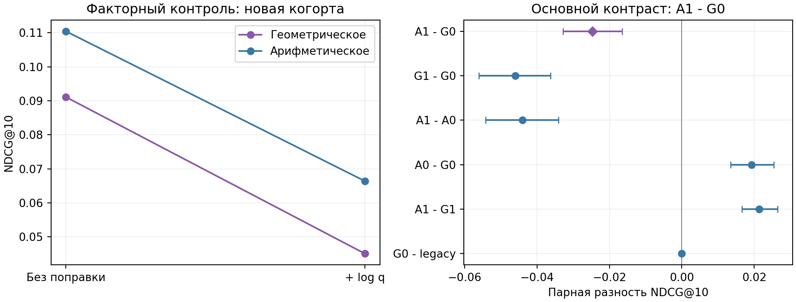

# Финальный контроль: масса вероятности и способ объединения истории

**Основное сравнение A1 - G0: -0.02471 NDCG@10, 95% user-cluster CI [-0.03280; -0.01652].** Интервал ниже нуля: совместная реконструкция ухудшила результат. Эта гипотеза не заменяется лучшей точкой из остальных вариантов.

## Дизайн и внешняя проверка

До настройки зарезервированы1000 новых UID, seed424242, вне всех UID v3. Сохранены все **5,204,381 listens**. Новая когорта не участвует в выборе alpha. Это другой набор пользователей того же сервиса и периода, не независимая временная репликация. Истории, графы, encoders и финальный manual обучены по прошлому новой когорты; supervised метки заканчиваются до297. Дни298/299 используются только после сохранения всех66 прогнозов. Полный [протокол](../../docs/RESEARCH_V4_PROTOCOL.md) зафиксирован до development-поиска.

Внутри каждой пары user-day общий pool до300 candidates, одинаковый всем методам. Нет positive injection, unretrieved/cold targets входят в Recall и IDCG. Seeds17/42/73 меняют encoder и manual. Усреднение: seeds внутри user-day, дни внутри user, затем пользователи. Bootstrap3000 целых пользователей, seed424242; неопределённость условна на fits и данном периоде.

## Факторная конструкция

Пусть f(i,j) - global-noise critic, q(j) - историческая частота target endpoints. В одном и том же C_u строим r_i(j)=softmax(f(i,j)+b*log q(j)). G_b=sum w_i log r_i(j), A_b=log sum w_i r_i(j). Для всех вариантов профиль24h, одинаковые source/target role masks, одинаковые encoder weights. Legacy - исходное среднее embeddings без новых masks. Нулевой q не сглаживается обучаемым параметром; fallback и floor1e-12 фиксированы протоколом.

Нормировка по C_u делает A1 смесью candidate-conditioned экспертов. Она не гарантирует восстановление полной generative probability; смесь с историческими весами не совпадает автоматически с условной версией глобальной смеси. Формула из Bayes/NCE и различие geometric/arithmetic pooling известны. Вклад - конкретная проверяемая конструкция, раздельные контроли и внешний перенос, без заявления мирового приоритета.

## Полные результаты

| method | NDCG@10 | Recall@10 | MAP@10 | delta vs manual, CI95 |
| --- | --- | --- | --- | --- |
| manual | 0.21944 | 0.13756 | 0.15740 | - |
| legacy | 0.09111 | 0.05361 | 0.05443 | -0.12833 [-0.14302; -0.11432] |
| G0 | 0.09111 | 0.05367 | 0.05438 | -0.12833 [-0.14300; -0.11433] |
| G1 | 0.04507 | 0.02534 | 0.02382 | -0.17436 [-0.19363; -0.15557] |
| A0 | 0.11043 | 0.06615 | 0.06929 | -0.10901 [-0.12137; -0.09647] |
| A1 | 0.06639 | 0.03554 | 0.03690 | -0.15304 [-0.16995; -0.13618] |
| fusionG0 | 0.21944 | 0.13756 | 0.15740 | +0.00000 [+0.00000; +0.00000] |
| fusionG1 | 0.21944 | 0.13756 | 0.15740 | +0.00000 [+0.00000; +0.00000] |
| fusionA0 | 0.21944 | 0.13756 | 0.15740 | +0.00000 [+0.00000; +0.00000] |
| fusionA1 | 0.21944 | 0.13756 | 0.15740 | +0.00000 [+0.00000; +0.00000] |
| repeat | 0.19948 | 0.12866 | 0.14418 | -0.01996 [-0.02781; -0.01215] |
| popularity | 0.01581 | 0.00880 | 0.00621 | -0.20363 [-0.22413; -0.18268] |
| userknn | 0.03073 | 0.01429 | 0.01275 | -0.18871 [-0.21002; -0.16778] |



| contrast | delta | CI95 |
| --- | --- | --- |
| A1_minus_G0 | -0.02471 | [-0.03280312665888835, -0.016524964407802944] |
| G1_minus_G0 | -0.04603 | [-0.05612798674368564, -0.0363098582628385] |
| A1_minus_A0 | -0.04404 | [-0.05421722913944206, -0.03411533049604652] |
| A0_minus_G0 | 0.01932 | [0.01344611208333976, 0.0254518339730519] |
| A1_minus_G1 | 0.02132 | [0.01664352403009597, 0.02650176594760864] |
| G0_minus_legacy | 0.00000 | [-0.00014267602892317278, 0.00014990645259796648] |

Запланированное взаимодействие (A1-A0)-(G1-G0): +0.00200, описательный95% CI [-0.003718747157382857, 0.008023881591245773]. Это контраст NDCG, не самостоятельная NDCG-метрика.

Только A1-G0 является основным сравнением. Другие контрасты описательные, без поправки на множественность. Успех отдельной арифметической агрегации не делает её новым primary задним числом. Сравнение с сильным manual публикуется отдельно и не подменяется сравнением двух слабых standalone методов.

## Настройка на прежнем search

| method | ndcg@10 | recall@10 |
| --- | --- | --- |
| G0 | 0.07949 | 0.04436 |
| G1 | 0.03834 | 0.02170 |
| A0 | 0.11684 | 0.07505 |
| A1 | 0.05685 | 0.03544 |
| legacy | 0.07931 | 0.04433 |

| method | alpha | ndcg@10 |
| --- | --- | --- |
| G0 | 0.00000 | 0.22078 |
| G0 | 0.05000 | 0.21912 |
| G0 | 0.10000 | 0.21512 |
| G0 | 0.25000 | 0.21254 |
| G0 | 0.50000 | 0.21108 |
| G1 | 0.00000 | 0.22078 |
| G1 | 0.05000 | 0.21880 |
| G1 | 0.10000 | 0.21648 |
| G1 | 0.25000 | 0.21259 |
| G1 | 0.50000 | 0.20471 |
| A0 | 0.00000 | 0.22078 |
| A0 | 0.05000 | 0.21994 |
| A0 | 0.10000 | 0.21669 |
| A0 | 0.25000 | 0.21241 |
| A0 | 0.50000 | 0.20569 |
| A1 | 0.00000 | 0.22078 |
| A1 | 0.05000 | 0.21894 |
| A1 | 0.10000 | 0.21715 |
| A1 | 0.25000 | 0.21128 |
| A1 | 0.50000 | 0.20507 |

Проверены20 вариантов fusion (4 score ×5 alpha), только старый search294, seed17. Выбранная процедура: G0, alpha=0.0. При alpha0 score точно равен manual; тождественный CI[0,0] не доказывает эквивалентность разных моделей. Окно24h, encoder и manual depth7/550trees не перенастраивались. Все trials сохранены, включая отсутствие прироста.

## Стоимость, исполнение и ограничения

Новая когорта потребовала48 neural fits для исходного общего retrieval (8snapshots ×2noise ×3seeds) и3 финальных manual fits. Новые четыре способа объединения используют те же сохранённые global embeddings, дополнительных neural fits у них нет. Предсказание смеси требует O(L*K*d) вместо O((L+K)*d) для среднего embedding; L<=100, K<=300, d=64. Сумма записанных wall durations завершённых стадий 1186.5s, max RSS одного процесса 4512.8MiB. Перекрывающиеся fits не дают изолированный elapsed benchmark.

Все66 массивов predictions воспроизведены; label/query_id удалены из входа manual. Заменено содержание будущих событий:6 реконструкций и2 полных candidate/feature таблицы совпали точно. SHA моделей, входов, recipe и прогнозов сохранены в evidence. Проверка пересчитывает метрики, агрегацию и интервалы без raw data/GPU. Кэши, модели и полные predictions остаются в runs/v4.

Ограничения v3 остаются: активная исходная Yambda-популяция, только1000 пользователей в когорте, два дня и общие items, условный bootstrap, неполная поддержка и logging policy. Нет impressions/online A/B; likelihood proxy и next-day relevance - разные цели. Новая когорта закрывает повторное использование тех же UID, но не заменяет проверку на будущем периоде. Срезы discovery/exposure описательны и не меняют выбор.

## Воспроизведение

После воспроизведения v3 и его development-кэшей:

```powershell
uv run --locked python scripts/research_v4.py reserve --root runs/v4-reproduction
uv run --locked python scripts/research_v4.py development --root runs/v4-reproduction --base runs/v3
uv run --locked --extra neural python scripts/research_v4.py external --root runs/v4-reproduction
uv run --locked python scripts/replay_v4.py --run runs/v4-reproduction
uv run --locked python scripts/audit_exposure_v3.py --run runs/v4-reproduction
uv run --locked python scripts/report_v4.py --run runs/v4-reproduction --output reports/v4-reproduction
uv run --locked rec verify --report-dir reports/v4
```

Период этой когорты теперь открыт. Изменение параметров по её результатам требует ещё одной новой проверки.
